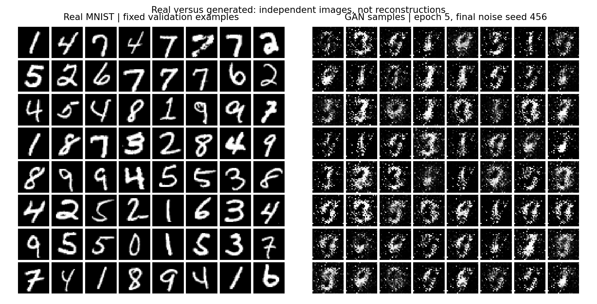

# Results

**Final closure, 2026-09-17:** the learner has finished the GAN topic, including
Session 5 and the Fashion-MNIST extension. The observed coverage limitation
is recorded as likely partial mode collapse / mode dropping, not a measured
class-recall result. Discussed remedies were not run and are not pending work.

Session 5 closed the core Week 8 learning work on 2026-09-17. The
[lab note](LAB_NOTE.md) and [assessment record](session5.md) summarize the
results and guided corrections. The separate [Fashion-MNIST CNN extension](fashion_mnist_extension.md)
also completed successfully afterward.

## Fashion-MNIST CNN Extension - 2026-09-17

One CNN-only, seed-42 run completed twenty epochs and 8,600 paired updates
using the unchanged architecture/optimizer settings on Fashion-MNIST. It ran
in four verified five-epoch segments with one immutable twenty-epoch config.

| Final D loss | Final G loss | Training seconds | Active segment seconds |
| ---: | ---: | ---: | ---: |
| 0.665465 | 1.862303 | 1,045.312 | 1,056.616 |

[Real/generated panel](results/runs/fashion_mnist_cnn_seed42_20epochs_20260917/real_vs_generated.png) ·
[5/10/20 progression](results/runs/fashion_mnist_cnn_seed42_20epochs_20260917/audit_epoch_05_10_20_progression.png) ·
[Losses](results/runs/fashion_mnist_cnn_seed42_20epochs_20260917/audit_d_g_losses.png)

Garment-like structure becomes clearer, but noisy/ambiguous textures remain.
The shown samples emphasize tops, dresses, and trousers, with little obvious
footwear or bag variety. This is a qualitative limitation, not generated-class
recall. Losses do not rank this dataset against MNIST or the earlier VAE.
All twenty checkpoint identities and final sample replays verified; complete
provenance is in [run notes](results/runs/fashion_mnist_cnn_seed42_20epochs_20260917/notes.md).

## Twenty-Epoch MLP/CNN Comparison - 2026-09-16

The CNN extended run completed; the existing twenty-epoch MLP was reused
after fresh verification. Both pairs processed 8,600 paired updates with
matching data splits, seeds, optimizer settings, and evaluation-noise panels.
The CNN recovered from a process termination at epoch 12 by restoring both
models, optimizers, and RNG states; recovery equivalence and final replay passed.

| Pair | Completed-epoch training seconds | Final D loss | Final G loss |
| --- | ---: | ---: | ---: |
| MLP | 100.959 | 0.525343 | 2.534042 |
| CNN | 1,098.076 | 0.729749 | 1.967853 |

[Side-by-side samples](results/runs/session4_mnist_cnn_seed42_20epochs_20260916/mlp_vs_cnn_epoch20.png) ·
[Loss curves](results/runs/session4_mnist_cnn_seed42_20epochs_20260916/mlp_vs_cnn_losses_20epochs.png) ·
[5/10/20 progression](results/runs/session4_mnist_cnn_seed42_20epochs_20260916/epoch_05_10_20_comparison.png)

The CNN samples are cleaner, more recognizable, and visibly more varied;
some remain ambiguous. The MLP still produces many 1-like outputs and
residual speckle. This supports a qualitative comparison of these two runs,
not general superiority or quantitative digit coverage. Both architectures
and capacities change, and GAN losses are not image-quality rankings.
CNN wall elapsed includes interruption/recovery and differs from the training
time above. See [notes.md](results/runs/session4_mnist_cnn_seed42_20epochs_20260916/notes.md)
for provenance, timing, verification, and limits.

## Session 4 CNN Comparison - 2026-09-16

The learner's CNN pair completed five epochs with the same MNIST split, seed,
batch size, optimizer settings, noise-panel seeds, and 2,150-update budget
as the five-epoch MLP baseline. All 25 checks passed; final checkpoints
reproduce both CNN panels and the original MLP final panel exactly.

| Pair | G parameters | D parameters | Training seconds | Final D loss | Final G loss |
| --- | ---: | ---: | ---: | ---: | ---: |
| MLP | 242,832 | 233,985 | 25.523 | 0.394094 | 3.368496 |
| CNN | 482,049 | 355,073 | 262.733 | 0.201683 | 9.202752 |

The [complete comparison panel](results/runs/session4_mnist_cnn_seed42_20260916/mlp_vs_cnn_epoch05.png)
shows cleaner CNN backgrounds and more continuous strokes. Many CNN samples
remain malformed or incomplete. Both networks and their capacities changed;
compute and training-noise trajectories are not matched. This is a one-seed
architecture-pair comparison, not proof of isolated convolution benefit or
full digit coverage. GAN losses do not rank sample quality across runs.

The [run notes](results/runs/session4_mnist_cnn_seed42_20260916/notes.md) contain
per-epoch results, failure analysis, limits, reproduction, and checkpoint paths.
The practical comparison is complete; learner discussion and the Session 5
lab note remain pending. The following sections retain the Session 3 record.

Session 3's practical MNIST baseline completed on **2026-09-15** after the
learner explicitly requested execution. The earlier conceptual discussions
remain recorded separately. All 11 verification checks passed, and the full
five-epoch run completed. [Run notes](results/runs/session3_mnist_mlp_seed42_20260915/notes.md) retain the setup,
interpretation, limitations, and reproduction instructions.

## Longer-Training Follow-Up

A separate [20-epoch run](results/runs/session3_mnist_mlp_seed42_20epochs_20260915/notes.md) completed on 2026-09-15 with the
same source, seed, data split, architecture, optimizer settings, and evaluation
noise. Its first five epochs match the original baseline's weights, optimizer
states, RNG states, metrics, and sample grids exactly. The original baseline
is preserved. Final epoch 20 was selected in advance.

| Epoch | D loss | G loss | Mean D(fake), after D update |
| --- | --- | --- | --- |
| 5 | 0.394094 | 3.368496 | 0.068469 |
| 10 | 0.380225 | 3.985224 | 0.060390 |
| 15 | 0.478200 | 2.663872 | 0.121032 |
| 20 | 0.525343 | 2.534042 | 0.132467 |

[Epoch 5/10/20 comparison](results/runs/session3_mnist_mlp_seed42_20epochs_20260915/epoch_05_10_20_comparison.png) ·
[Real versus generated at epoch 20](results/runs/session3_mnist_mlp_seed42_20epochs_20260915/real_vs_generated.png) ·
[Twenty-epoch curves](results/runs/session3_mnist_mlp_seed42_20epochs_20260915/training_curves.png)

The epoch-20 samples show a clear visual improvement: cleaner backgrounds,
sharper and more continuous strokes, and more recognizable individual digits.
This controlled comparison supports the learner's hypothesis that additional
training would improve the five-epoch images. Many outputs remain 1-like,
so limited diversity is a separate concern. Generated class coverage was not quantified.
Real-image acceptance is 86.22% on both training and validation; validation
real digit 1 has mean score 0.3029 and acceptance 14.86%. See the full per-digit
audit before attributing this behavior to a particular cause. This is still
one training seed, not a claim of general improvement.

## Measured Baseline

55,000 training images; seed 42; batch 128; two Adam optimizers at 0.0002;
MLP architecture with the learner's sigmoid/mean-BCE convention. D uses
LeakyReLU slope 0.01. Validation: 5,000 images; official test: 10,000 images,
unused in measured training, scoring, or selection. Final epoch 5 was selected
before training. Training time: 25.523 s on CPU with two threads.

| Epoch | D real BCE | D fake BCE | D total | G BCE | Training seconds |
| --- | --- | --- | --- | --- | --- |
| 1 | 0.290016 | 0.649639 | 0.939656 | 1.054339 | 5.35 |
| 2 | 0.263660 | 0.353082 | 0.616742 | 2.051750 | 5.01 |
| 3 | 0.245934 | 0.255527 | 0.501461 | 2.442401 | 5.07 |
| 4 | 0.242978 | 0.222170 | 0.465149 | 2.681651 | 5.01 |
| 5 | 0.211130 | 0.182964 | 0.394094 | 3.368496 | 5.07 |

These are sample-weighted epoch means. D scores and fixed-image diagnostics
are retained in [metrics.json](results/runs/session3_mnist_mlp_seed42_20260915/metrics.json) and
[training_curves.png](results/runs/session3_mnist_mlp_seed42_20260915/training_curves.png).

## Real Versus Generated

The complete generated panel uses independent final noise seed 456. The
[single-image comparison](results/runs/session3_mnist_mlp_seed42_20260915/real_vs_generated_single.png) uses the first
example from each declared panel. The columns are independent samples, not
reconstruction pairs. Fixed-noise seed-123 grids are retained for epochs 0–5.

Digit-like patterns emerge, but the samples remain speckled, malformed, and
less clean than real MNIST. Visual variety does not prove distribution
coverage. No all-3s result was established; that earlier lesson was hypothetical.

## Discriminator Audit And Limits

Real-image mean scores: training **0.9098**, validation **0.9073**. Real
acceptance at threshold 0.5: **95.80%** and **95.70%**. All ten digit groups
are present in the [per-digit audit](results/runs/session3_mnist_mlp_seed42_20260915/discriminator_by_digit.csv).
This audit does not show D accepting only 3s or a large train/validation gap;
it does not establish generated class coverage or absence of all overfitting.

This is a one-seed, five-epoch baseline, with qualitative generation assessment.
No claim of convergence, quantitative generation quality, or superiority over
other model families is made. Session 4's later comparison is recorded above;
the final Week 8 lab note remains pending.

## Reporting Rules

Session 3's runs, interpretation, and documentation are complete. Further
architecture comparisons belong to Session 4; they do not prevent closure
of this baseline and training-budget study.

- Add measured values only after matching command/output evidence exists.
- Report both discriminator terms and generator loss with their reductions.
- Present full sample grids and failure cases alongside training diagnostics.
- Distinguish visual impressions from measured distribution-quality claims.
- Keep historical Week 7 Fashion-MNIST VAE metrics separate from MNIST GAN
  results. An unconditional GAN has no paired reconstruction MSE here.
- State dataset, seed, budget, checkpoint policy, and evaluation limits for
  every comparison.
