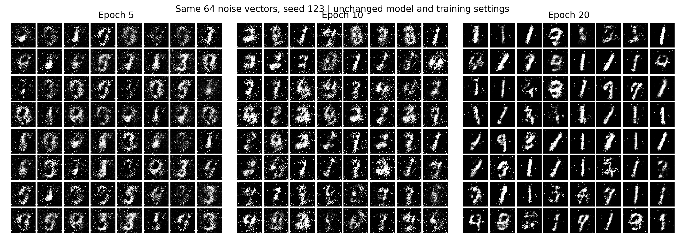

# Longer Training: Controlled 20-Epoch Follow-Up

Completed on 2026-09-15 after the learner explicitly requested longer training.
Run: session3_mnist_mlp_seed42_20epochs_20260915. The original five-epoch baseline is retained unchanged.

## Controlled Change

Only the training budget changed: five to twenty epochs. Architecture,
seed 42, MNIST split, batch 128, noise width 64, Adam settings, sigmoid/BCE,
LeakyReLU slope 0.01, CPU/two-thread execution, and evaluation noise seeds
were held fixed. The model was restarted from the same initialization in a
fresh run directory. At epoch 5, both networks, both optimizer states, both
saved RNG states, sample grids, and non-runtime metrics exactly match the
original baseline. This therefore extends the same training trajectory.
It is not a second independent seed.

The selected checkpoint was declared as final epoch 20 before training.
All 20 checkpoints and every fixed-noise panel from epoch 0 through 20 are
retained. Test images entered no measured training, scoring, or selection.

Training took 100.959 s; the recorded training/artifact/audit
phase took 111.343 s. Each epoch used all 55,000 training
images in 430 batches, for 8,600 paired D/G iterations. Peak RSS was
814.3 MiB.

## Results

| Epoch | D loss | G loss | Mean D(fake), after D update |
| --- | --- | --- | --- |
| 5 | 0.394094 | 3.368496 | 0.068469 |
| 10 | 0.380225 | 3.985224 | 0.060390 |
| 15 | 0.478200 | 2.663872 | 0.121032 |
| 20 | 0.525343 | 2.534042 | 0.132467 |

These are batch-weighted epoch means, not independent image-quality scores.
G loss peaked near epoch 10 before falling. The D/G loss changes alone do
not establish better coverage of the data distribution.



Visual inspection: epoch 20 has cleaner backgrounds and sharper strokes than
epoch 5. However, many samples now resemble digit 1 or similar vertical
strokes. This is a qualitative concern about mode concentration/limited
variety. No generated-digit classifier was used, so no class-frequency or
coverage estimate is claimed. Some samples remain malformed or speckled.

The independent seed-456 [real-versus-generated panel](real_vs_generated.png)
shows the same concern. The [single pair](real_vs_generated_single.png) is
index 0 from each predeclared panel, not a best-looking example. Full
[training curves](training_curves.png) and all intermediate grids are kept.

## Real-Image Discriminator Audit

Final mean real probabilities: training 0.8595, validation 0.8597. Real-image
acceptance at threshold 0.5 is 86.22% on each split. This is not overall
binary accuracy, and the similar train/validation values do not by themselves
prove the absence of overfitting.

For validation digit 1, mean D(real) is 0.3029 and only 14.86% are classified
real, compared with a mean 0.9070 and 98.37% real acceptance at epoch 5.
Several other digit groups retain high scores. Together with the many 1-like
outputs, this is consistent with a distribution-coverage problem; it is not
proof that D is memorizing training examples or that D alone caused it.
The complete per-digit values are in [discriminator_by_digit.csv](discriminator_by_digit.csv).

## Interpretation

Extra training helped visual clarity in this particular trajectory, so the
five-epoch budget was one limitation. It did not deliver a uniformly good,
diverse MNIST generator. Architecture/training dynamics still warrant a
controlled follow-up. Preserve both runs; do not reinterpret this as a
multi-seed result or select a different checkpoint retrospectively.

## Reproduction And Verification

Exact settings, command, split/source hashes, and versions: [config.json](config.json).
Per-epoch metrics and checkpoint paths/hashes: [metrics.json](metrics.json).
Actual output: [stdout.txt](stdout.txt). Audit: [verification.txt](verification.txt).
Executed sources are retained in sources/. They are byte-identical to those
of the previously verified baseline, so its 11 passing unit checks were reused.

The artifact audit verified all 20 checkpoint hashes, all epoch counts/loss
identities, identical initial five-epoch state, and all PNG structures. Loading
epoch 20 reproduced both final generated panels exactly. The three-epoch
comparison was rendered from checkpoint weights with the same 64 seed-123
noise vectors; no hand-picked examples or image cleanup were used.

Run from the repository root with a fresh output directory:

```bash
PYTHONDONTWRITEBYTECODE=1 MPLCONFIGDIR=/tmp/week08-mpl-run OMP_NUM_THREADS=2 MKL_NUM_THREADS=2 OPENBLAS_NUM_THREADS=2 python3 -u phase01_research_engineering/week08_gans/run_baseline.py --device cpu --epochs 20 --batch-size 128 --seed 42 --threads 2 --out-dir phase01_research_engineering/week08_gans/results/runs/session3_mnist_mlp_seed42_20epochs_repeat
```

External checkpoints: /home/rui.gao/data/ai_research_roadmap/checkpoints/week08_gans/session3_mnist_mlp_seed42_20epochs_20260915
