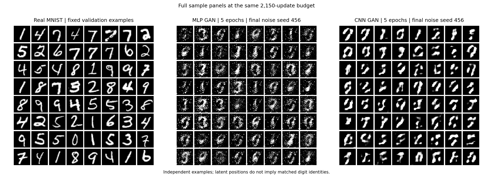

# Five-Epoch CNN GAN Comparison

Date: 2026-09-16. Status: completed, exit 0.
The learner explicitly requested argument/configuration integration and this
five-epoch experiment after implementing the CNN model pair.

## Setup And Reproduction

The preserved Session 3 five-epoch MLP run is the comparison baseline. This
run uses MNIST, seed 42, batch 128, five epochs, 64-dimensional Gaussian noise,
sigmoid/mean BCE, separate Adam optimizers at 0.0002 with betas (0.5, 0.999),
CPU with two threads, and zero loader workers. The train/validation/test
split is 55,000/5,000/10,000; test images did not enter measured optimization,
scoring, or selection. Epoch 5 was selected in advance.

The exact invocation is stored in [config.json](config.json) and
[stdout.txt](stdout.txt). To reproduce, choose a fresh output directory:

```bash
PYTHONDONTWRITEBYTECODE=1 MPLCONFIGDIR=/tmp/week08-cnn-reproduction OMP_NUM_THREADS=2 MKL_NUM_THREADS=2 OPENBLAS_NUM_THREADS=2 python3 -u phase01_research_engineering/week08_gans/run_baseline.py --architecture cnn --device cpu --epochs 5 --batch-size 128 --seed 42 --noise-dim 64 --lr 0.0002 --threads 2 --num-workers 0 --out-dir phase01_research_engineering/week08_gans/results/runs/session4_cnn_reproduction
```

This runs the learner's resize-then-convolution generator and convolutional
discriminator with a two-layer classifier head. It is not a canonical DCGAN
reproduction. Resolved layer descriptions and counts are recorded in config.

## Measurements

| Model pair | G parameters | D parameters | Paired updates | Training seconds | Final D loss | Final G loss |
| --- | ---: | ---: | ---: | ---: | ---: | ---: |
| Session 3 MLP | 242,832 | 233,985 | 2,150 | 25.523 | 0.394094 | 3.368496 |
| Session 4 CNN | 482,049 | 355,073 | 2,150 | 262.733 | 0.201683 | 9.202752 |

| Epoch | D loss | G loss | Training seconds |
| --- | ---: | ---: | ---: |
| 1 | 0.124429 | 5.972341 | 51.334 |
| 2 | 0.000344 | 8.899202 | 52.283 |
| 3 | 0.000114 | 9.953066 | 52.145 |
| 4 | 0.000056 | 10.700823 | 52.888 |
| 5 | 0.201683 | 9.202752 | 54.084 |

Epoch losses are sample-weighted means. Full D real/fake terms, within-step
scores, fixed-reference scores, and runtime are in [metrics.json](metrics.json).
Recorded training/artifact/audit time was 269.021 seconds; peak process RSS
was 916.219 MiB. Historical wall-clock times are illustrative, not a dedicated
hardware performance benchmark.

## Visual Comparison And Limits



The CNN has much cleaner backgrounds and thicker, more continuous strokes
than the five-epoch MLP. Many CNN outputs remain malformed, incomplete, or
ambiguous as digits. This is evidence of better local visual structure in
this comparison, not complete mode coverage or convergence. All 64 generated
examples are shown; no attractive examples were selected.

Both G and D changed, and capacity/compute increased. Dataset order, update
budget, split, optimizer settings, and evaluation noise seeds match. Model
initialization consumes different amounts of global RNG, so the training
noise trajectories are not identical. Equal final-noise positions do not
imply matched digit identities. One seed, visual inspection, and GAN losses
do not establish quantitative distribution matching or general superiority.

Final real-image discriminator acceptance was 61.18% for training and 61.30%
for validation; mean real probabilities were 0.575039 and 0.575335. These
real-only audits are neither generated-digit coverage nor overall binary
accuracy. A small train/validation gap alone does not prove the absence of
overfitting. See [discriminator_by_digit.csv](discriminator_by_digit.csv).

## Verification And Retained Artifacts

- All 25 CPU tests passed, zero skips; focused lint and runner type checks passed.
- All 18 compared configuration fields match the five-epoch baseline.
- All five current source hashes match the saved snapshots; the original MLP
  class definitions and data/update code remain unchanged.
- Five epochs each processed 55,000 images in 430 batches; 2,150 paired updates.
- All five external checkpoint hashes match; every epoch panel is retained.
- Final checkpoints reproduce both CNN generated panels and the original
  MLP final panel byte-for-byte.
- CSV/JSON audit counts agree; generated PNG structures passed verification.

Checkpoints are under
`/home/rui.gao/data/ai_research_roadmap/checkpoints/week08_gans/session4_mnist_cnn_seed42_20260916/`.
Their exact paths/hashes are in metrics. The run retains config, metrics,
stdout, source snapshots, verification, five checkpoint references, twelve
PNG figures, and the real-image discriminator audit. No previous run was
overwritten. CUDA and independent-seed replication were not tested.

[audit_and_compare.py](audit_and_compare.py) reproduces the artifact checks
and comparison figure from the saved checkpoints. Run it from the repository
root with the same two-thread environment; it updates the comparison PNG.
Full output is recorded in [verification.txt](verification.txt).

Next learning step: discuss the stronger local strokes, incomplete digit
structure, training trajectory, and what this comparison can establish.
The final Week 8 lab note remains future Session 5 work.
